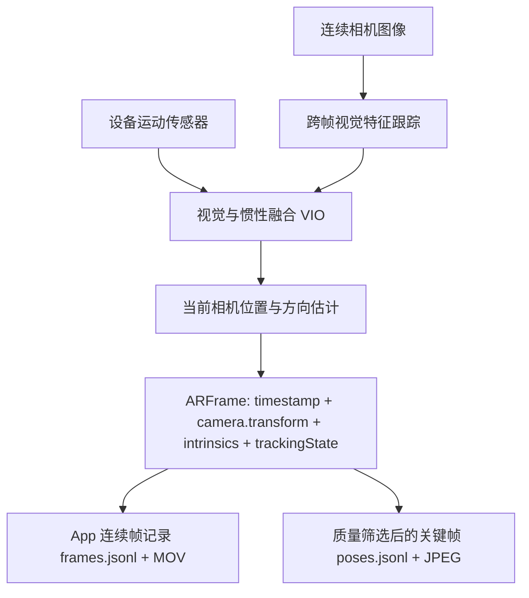

# 采集与存储

2026-11-12 导出内存修复：手机 Jetsam 确认约 6 GiB 时触发 per-process-limit。SceneZipWriter 在每个 1 MiB 读取/CRC/写入块内增加 autoreleasepool，防止 FileHandle 的 Foundation 临时缓冲随 ZIP 大小累积；ARC 变量离开作用域不足以保证这些临时对象即时释放。482 帧本机最大 RSS 从约 460 MB 降至 39 MB，输出字节与 CRC 不变；回归及双目标构建通过，尚未安装此修复或复测手机。证据及限制见 README 第 3 节。

2026-11-12 打包更新：`BetaSceneArchive` 使用 `SceneZipWriter` 以 1 MiB 分块流式写 ZIP64，zlib 计算 CRC32，文件名直接标记 UTF-8，不再次压缩媒体。临时导出目录优先硬链接不可变媒体，失败时复制；JSONL/清单独立写入，不修改原始采集数据。检查/整理按文件数量报告进度，ZIP 按字节报告，发布成功才到 100%。单个和批量界面均显示阶段及百分比。真实样本的计时、包体增大和验证边界见 README 第 3 节，真机速度仍待验证。

2026-11-12 抽帧时机调整：仅对新拍摄，停止后等待全帧 JPEG/位姿/连续索引与视频收尾完成，再在临时目录生成独立的 `sampled_0.5s/`（首帧起至少 0.5 秒间隔），成功后原子移动到该新场景内，随后才进入预览并标记处理完成。全帧原始图像与参数不改写；失败/取消不发布半写抽帧目录，也不标记整体成功。已有场景、已有抽帧目录和已保存 ZIP 不自动补写或覆盖。新场景导出复用持久化抽帧 ID，并检查来源摘要；关闭导出深度只影响导出副本，不改变已生成抽帧目录。旧场景缺少该目录时仍可在导出临时副本生成，手机原目录不改。按用户要求本次只改代码和做本地验证，不连接或安装手机。


2026-11-12 双份导出真机验收（单次场景）：已只读取回用户新拍摄的 `scan_20261112_105224_3A3E97` 原始目录和手机生成的 `scan_20261112_105224_3A3E97-arkit-2BB28A02.zip`。原 ARFrame 索引、原 JPEG、全帧 JSONL 均为 482 帧，时间戳跨度 16.033534 秒，实际约 29.9996 fps，1920×1440；482 帧跟踪均为 normal，均有同步深度/置信度。额外 `sampled_0.5s/` 为 33 帧和 33 对深度，实际相邻间隔 0.500006083–0.500006375 秒，严格匹配首帧起每隔至少 0.5 秒的选择规则。视频编码实际写入 480 帧，另外 2 帧的独立 JPEG、原始参数及深度仍保留，未被导出剔除。

ZIP 为 316,786,849 字节、1,551 个文件；CRC、精确目录白名单、同 ID 对应、全部 JPEG 解码/尺寸/方向、深度字节数和置信度取值、全部原始 K/c2w、GL/OpenCV 逆矩阵、所有导出媒体与原始文件逐字节一致，以及抽帧副本与全帧参数/媒体一致均通过。导出清单来源摘要与手机原 poses.jsonl / frames.jsonl 相符；取回的 2,417 个原始文件在本地验证前后摘要未变。本次仅执行读取，不修改手机场景。证据位于 `.build/device-dualframes-validation/validation.json`、`latest.zip`、`source/` 与 `validate.py`。本次完成该场景的全帧与双份 ZIP 验收，不代表长时录制、4K、温度/内存压力或独立几何精度验收。


2026-11-12 双份导出：保留场景根目录的全帧 ARKit 数据，额外生成 `sampled_0.5s/`，内部同样包含 scene-package.json、arkit/frames.jsonl、arkit/poses.jsonl、images/ 和可选 depth/。按原 ARFrame.timestamp 时间排序，保留首帧，之后选择距上一保留帧至少 0.5 秒的第一帧；不追加不足间隔的末帧，不叠加质量筛选，不改变原 ID、参数和媒体字节。清单 schemaVersion 8，抽帧副本注明 samplingIntervalSeconds=0.5、sourceFrameCount 及实际 frameCount。只从导出临时全帧副本生成，手机原始采集数据不改动；单个和批量导出均包含两份。


2026-11-12 全帧保留调整：Beta 拍摄取消 0.5 秒关键帧间隔及位移/清晰度/跟踪筛选，对采集期间收到的 ARFrame 逐帧复制 JPEG、原始 K/c2w 和可用的同帧深度。JPEG 队列上限 8；复制/写入失败或队列满则停止并保留已有文件，不能静默跳帧后标记成功。收尾核对连续索引帧数与已写 JPEG 数量，并在 beta-capture.json 记录 inputARFrameCount / savedImageFrameCount。精简导出 schemaVersion 7 保留全部已保存帧，不按模糊、跟踪、视频丢帧或深度质量筛选；深度缺失保留图像并标记 not_captured，必需文件缺失/损坏时报错而非减少帧数。已有拍摄目录不改写；旧场景未保存为 JPEG 的帧不会凭空补出。JPEG 沿用现有编码，不等于传感器 RAW。实际持续帧率、写入压力及真机完整性尚待验证。


2026-11-11 精简导出更新：App 内 ARKit 拍摄场景默认单个/批量保存仅包含 `scene-package.json`、`arkit/frames.jsonl`、`arkit/poses.jsonl`、`images/*.jpg` 和可选 `depth/*.f32` / `*.u8`（schemaVersion 6）。不带视频、点云和摄影测量结果，不依赖相机重估；手机原始数据保留。读取字段和坐标契约见 [数据保存格式](数据保存格式.md)。普通视频导入继续使用既有非米制归档。精简导出版本已于 2026-11-11 完成 Release 签名原位安装到“云山”并启动；手机实际 ZIP 与拍摄交互仍待验收。


2026-11-11 采集默认流程调整：Beta 停止拍摄后仅完成原始 ARKit 视频、关键帧、位姿及可选 LiDAR 的安全收尾和预览保存，不自动运行摄影测量，不显示全屏计算动画；收尾期间禁用采集操作，完成后进入预览。单个和批量导出默认选择“原始归档”，可直接保存 ARKit 数据。摄影测量保留为场景页手动操作，“重建结果”仍要求有效估计与配准，不伪造结果。此次真机拍摄交互尚未验收。


对外读取场景 ZIP 的完整文件清单、字段类型、相机坐标及深度二进制约定见 [数据保存格式](数据保存格式.md)。本篇侧重采集实现、导出流程与验证记录。

## 场景视频预览方向（build 12）

`BetaVideoPreview.swift` 为传感器方向的 ARKit 视频建立仅驻留内存的 `AVMutableComposition`，通过视频轨道的 `preferredTransform` 调整显示方向；播放器控件保持正向。原视频已有显示变换或来自普通视频导入时，沿用自身方向，不重复旋转。旧采集没有记录 UI 朝向，因此依据首帧 ARKit 相机与重力的关系选择 90° 整数倍旋转；重力投影过小时（例如接近垂直向下拍摄）无法确定朝向，使用竖屏默认。当前两次真实竖屏采集均为顺时针 90°。一次播放使用固定朝向，不逐帧校正拍摄期间的手机滚转。

该变换只用于场景页显示，不重新编码、不修改 MOV/JPEG、内外参、时间戳或深度。实际解码回放中，1920×1440 原片的预览画面转正为 1440×1920，原视频和 `poses.jsonl` 字节保持不变。现有原始包和重建包格式不变。

## 筛选后的重建包（build 13）

单个/批量保存默认选择“重建结果”；“原始归档”保留完整采集索引、视频、原始/估计相机和点云。`BetaReconstructionExport.swift` 按允许名单建立新目录，`BetaSceneArchive.swift` 原子发布 ZIP，不改写手机原场景。结果筛选检查原始参数、质量标记、同时间连续帧写入状态、normal 跟踪、RealityKit 有效相机名单、图像与参数对应；包含 LiDAR 时再检查深度尺寸、字节数、置信度及与连续深度逐字节一致性。报告过期、来源变化、结果缺失或零有效帧时拒绝发布；批量任一场景失败则整批不发布。关闭 LiDAR 导出时不要求深度，可能保留更多图像，但两套相机和图像 ID 始终一致。

| 重建包路径 | 语义 |
| --- | --- |
| `scene-package.json` | schemaVersion=5，kind=beta-reconstruction-scene；声明米制世界、默认相机、筛选和深度策略 |
| `images/` | 只复制通过筛选的原 JPEG，不改像素、不重新编号 |
| `arkit/poses.jsonl` | 对应有效帧的原始 K/c2w，另附 GL/OpenCV w2c |
| `realitykit/poses.jsonl` | 同一帧集合的估计 K 和已配准至原 ARKit 米制世界的外参；默认重建输入 |
| `realitykit/native-cameras.json`、`alignment.json` | 同一有效帧的未配准返回值及已应用的全局变换；拟合排除不等于相机无效 |
| `frames.jsonl` | 有效帧 ID、时间、图像、原连续 sourceFrameID；可选原始深度/置信度引用及尺寸 |
| `depth/` | 可选，仅有效帧；depthCalibrationPoseFile 指向 arkit/poses.jsonl，原始 K 按深度尺寸缩放，不能替换成估计 RGB K |
| `selection.json` | 接受 ID、排除 ID/原因、连续丢帧 ID、来源文件 SHA-256、估计是否用深度及导出前配准统计 |

最终重建包不包含完整视频、原连续深度目录或未按有效帧重新生成的点云，避免被剔除帧通过其他文件重新进入重建。审计报告保留被剔除 ID 与原因，但不携带其图像或相机参数。普通视频分支仅有 `poses.jsonl` 一套真实估计相机，并明确任意尺度，不生成 ARKit 参数。源码回归入口 `bash tools/test_beta_scene.sh` 同时覆盖原始归档与筛选导出；真实数据可用该脚本的 `--reconstruction /场景路径` 参数回放实际归档代码。

## 目的与输入输出

首页“开始扫描”先显示拍摄准备页，提供“仅相机”和“相机 + LiDAR”两种方式，并记住选择。不支持 LiDAR 的设备禁用对应选项；相机内的拍摄前设置与准备页保持一致。两种方式共用一种默认画质，优先约 1080p / 30 fps，实际尺寸/帧率由 ARKit 支持格式决定。

iPhone 采集链路从同一 `ARFrame` 读取 RGB、时间戳、内参、相机位姿、追踪状态及所选模式实际提供的 `sceneDepth`，由 AVFoundation 编码视频，不另开相机会话。`sceneDepth` 是公开 API 提供的深度，不是 LiDAR 原始回波，也不保证每帧都有。

| 输出 | 约定 |
| --- | --- |
| `color.mov`、`color-0001.mov` 等 | H.264 SDR、实际原生尺寸；续拍新增分段 |
| `frames.jsonl` | 连续帧索引，包含视频写入状态、相机参数、追踪和深度引用 |
| `capture-meta.json` | 设备/系统、实际格式、坐标/时间语义、分段、完成或失败状态；兼容读取旧 `meta.json` |
| `capture-processing.json` | 拍摄后的处理状态、阶段、进度、LiDAR 模式和开始/更新时间；与视频流状态分开记录 |
| `depth/continuous/` | 连续深度与置信度，和关键帧深度分开保存 |
| `images/`、`poses.jsonl`、`depth/` | 关键帧图像、原始相机记录和可用深度，保留训练输入 |

## 实现入口与约定

App 内入口为 `Capture/UI/CapturePreparationView.swift`、`Capture/CaptureMode.swift`、`Capture/CaptureController.swift`、`CaptureStreamRecorder.swift`、`CaptureSessionConfiguration.swift`、`Models.swift` 和 `ExportManager.swift`，均位于 `arkit-3dgs-scanner/` 下。

仅相机模式使用多视角图像、真实 ARKit 位姿和图像特征重建点云，不启用 `sceneDepth`、场景网格或深度文件写入；LiDAR 模式按能力启用同步深度融合，两者都保存连续视频与关键帧。LiDAR 开关不会将普通视频导入变成含传感器深度的数据。

格式选择优先后置广角、长边 1920、30 fps；设备未提供该组合时保留 ARKit 默认格式，不强行裁切或补帧。代码关闭 HDR，首帧记录实际尺寸、格式帧率、相机类型和位置；按能力与配置启用深度及场景网格。

`frames.jsonl` 中 `frameID` 为整数；`timestamp` 为系统启动后秒数（Double）；`videoWritten` 为布尔值；`videoFile`、`videoPTS`、`dropReason` 为可选字段。每段首个成功写入帧的 `videoPTS` 为零，后续按真实帧间隔写入，`timestamp - videoPTS` 可还原该段时间偏移，不将开头被拒收的帧当作起点。

内参 `fx/fy/cx/cy` 为像素单位 Double，`width/height` 为整数。`transform` 是 16 个 Double 的行主序 c2w：ARKit/GL 相机 X 右、Y 上、朝 −Z，世界重力对齐，单位米。深度 `.f32` 为小端 Float32 米制值，置信度 `.u8` 为 UInt8，均逐行紧密排列；记录各自文件路径及深度宽高，不沿用 RGB 尺寸。

相机位姿本身不包含内参：`ARFrame.camera.intrinsics` 提供针孔内参，`ARFrame.camera.transform` 提供相机到世界的位姿，两者在同一个回调中读取并分别写入 `frames.jsonl`；选中的 JPEG 另在 `poses.jsonl` 保存同帧参数。`K = [[fx,0,cx],[0,fy,cy],[0,0,1]]`。常用世界到相机外参为 `T_w2c_arkit = inverse(T_c2w_arkit)`；保持原世界坐标、改用 OpenCV 相机轴时，`T_w2c_opencv = diag(1,-1,-1,1) × inverse(T_c2w_arkit)`，其前三行是 `[R|t]`。不能直接把原始 c2w 的平移当作 w2c 的 t，也不能把 ARKit 相机轴直接当成 OpenCV 相机轴。训练 COLMAP 导出还可能应用世界翻转，应另读 `training-coordinate-frame.json`。

内参对应原始传感器方向的图像尺寸，图像缩放、裁切或旋转后必须同步变换相机参数。保存格式不包含镜头畸变系数，不能将未保存解读为畸变为零。ARKit 位姿是局部世界中的估计值，不是 GPS 坐标或测量真值。连续视频使用 `videoWritten=true` 的记录，按 `videoFile` 和 `videoPTS` 对应视频样本；关键帧按 `timestamp` 对应连续帧，不能假定两种索引的 ID 相同。Beta 完整场景 ZIP 保留这些参数，即使导出时关闭 LiDAR 也只移除深度相关字段。仅分享 MOV 不携带这些 JSON 索引。

回调内复制像素和深度后入队，异步写入不持有原始 ARFrame。最多保留 3 个待写媒体包，超过时保留参数索引并记 `media_backpressure`；编码器暂忙记 `writer_backpressure`，复制失败记 `color_copy_failed`。索引任务积压达到 256 时停止并标记失败。单个 actor 顺序写视频、深度和索引。

停止先等待待写任务，再结束片段；续拍沿用会话坐标系并创建新 MOV。空片段被移除；全程无视频样本或收尾失败持续报告失败，不因重复调用变为成功。导出前完成写入和元数据收尾，再生成 COLMAP `sparse/0/`、点云、另存的优化位姿并打包 ZIP；原始图像、深度和位姿保留。

拍摄需要前台相机会话；切换其他 App 不能继续采集相机/ARKit。结束拍摄后的位姿、点云处理通过 `Background/ContinuedProcessingLease.swift` 申请 CPU 持续后台任务，只有实际获准后才允许后台计算。未获准、系统取消或任务到期走停止与数据保护；系统取消即使发生在前台也必须响应。强制结束 App 不支持持续运行，不能把申请成功当作完成或授权。

CPU 后台放行还要求最后图像、视频和相机/可选 RoomPlan 收尾完成，不能在这些仍可能使用 GPU 的阶段提前显示可后台。中断后 `capture-processing.json` 标记 stopped，不能因 `capture-meta.json` 录像完整而误标重建成功。当前采集页仍保留时，“重新处理”可重新跑处理流程；App 重开后，有真实 depthFile 的扫描可用历史“优化训练数据”重新处理位姿与融合，仅相机历史优化不会补做 RGB 点云，必要时从已保存视频重新导入。不能承诺跨重启恢复完整采集处理进度。

当前 Personal Team 不支持后台 GPU 签名；默认版本的 CPU 申请不因此等同于视频摄影测量或 3DGS 获得后台 GPU。具体构建限制见 README，任务能力与事件记录在 `Documents/background-processing.json`。

### 采集预设与对焦：2026-11-03 官方 API 核对

用户本轮明确目标为每次采集内部统一的米制坐标，不要求多次会话共用固定原点；工作距离暂未确定。内参 K 对应图像像素，外参将相机与本次 ARKit 世界关联，不对 K 做世界坐标变换。自动对焦可能影响内参，但实际内参变化不能仅凭 K 归因于对焦；当前原始记录未保存镜头位置，尚不能完成因果核对。

Apple 的 [ARKit 自动对焦 API](https://developer.apple.com/documentation/arkit/arworldtrackingconfiguration/isautofocusenabled) 默认启用自动对焦。本机 SDK 的 `ARConfiguration.h` 与此一致。已核对的公开接口没有适用于任意场景的重建专用锁焦/曝光数值预设。`AVCaptureDevice` 可锁定对焦、曝光和白平衡，但 [lensPosition](https://developer.apple.com/documentation/avfoundation/avcapturedevice/lensposition) 是 0–1 的设备镜头位置，不是米制距离，也不能跨设备解释为相同焦距或对焦距离。调整 ARKit 底层 capture device 还可能影响追踪，应通过真实图像和 trackingState 验证。

建议的基础采集协议沿用固定后置广角、优先原生 1920 长边/30 fps、SDR 和逐帧 K/c2w；实际格式仍取决于设备，不能把所有原生画幅统一写成 1920×1080。未知工作距离时保留自动对焦，评价清晰度和重投影误差。受控锁定实验应先完成目标对焦及曝光收敛，再锁住实际镜头位置、曝光时长/ISO、白平衡增益；距离变化必须重新检查清晰度。锁焦后仍读取逐帧 K，不承诺 K 恒定或精度必然提高。固定参数也不能保证环境光与被摄距离相同。

当前 `CameraControls` 已能手动设置镜位、曝光和白平衡；`lockForScan()` 自动锁定曝光/白平衡时仍保留自动对焦，Beta 默认不自动锁定。尚无完整的跨次采集预设保存、异步设置生效确认及逐帧实际镜位/白平衡记录。下一步若实现可复用预设，需同时保存请求值与实际回读值、设备/镜头/格式、设置完成状态及时间来源；AVCaptureDevice 回读不能伪称为与 ARFrame 硬件同步的元数据。退出或失败仍恢复现有自动设置。后续实现保留自动对焦并默认启用可用 LiDAR，未新增锁焦预设或锁焦效果验收。

## 已有视频的存储

首页“使用已有视频”不创建 ARFrame 或伪造 `capture-meta.json`。Photos 提供的临时文件及 Files 安全作用域文件先复制到 `Application Support/video-imports/<UUID>/`；后续抽帧、相机和点云只在该次私有目录生成。成功后完整目录移动至 `Documents/scans/scan_video_<UUID>/`，保存原片副本及 `video-source.json`、`video-frames.json`、`video-import.json`；取消仅清理自身暂存，用户照片/文件原片不变。系统选片和载入应在前台完成；开始准备后，视频抽帧与摄影测量只有在后台 GPU 能力、签名 entitlement 与实际任务授权同时满足时才能在后台继续。缺少授权时切后台、用户取消或任务到期都会安全停止，先等待处理退出再清理本次未发布输出，原片保留。处理失败可重新开始；抽帧/摄影测量尚不支持断点恢复，训练另使用检查点机制。

## 验证方法

`bash tools/test_capture_stream.sh` 检查生产 NV12 复制与编解码、解码 PTS、深度、续拍和收尾。`python3 tools/test_capture_package.py` 检查包结构及损坏输入；真实包使用 `python3 tools/validate_capture_package.py <扫描目录>`，应同时验证视频解码和逐帧对应关系。

## 实际结果与限制

本轮 Mac 合成 NV12 回归和采集包验证通过，日志见 `.build/verification/capture-stream.log`；13 项 Python 采集包回归通过。已覆盖首帧背压不产生额外视频样本、空续拍片段移除、零样本失败保持及诊断索引保留。构建仍有 AVFoundation API 弃用警告。

2026-10-23 新增拍摄模式的 7 项 CPU 检查通过，覆盖模式偏好、无 LiDAR 设备回退和能力选择，日志为 `.build/feature-reconstruction-20261023/capture-mode-check.log`。这不证明真实深度已被采集，也不证明后台任务已在手机获准。

这些结果仅验证 Mac 编解码和文件契约。真机支持格式、RGB/深度/位姿对齐、权限与中断行为、磁盘异常、耗时、内存及热性能尚未验收，不能据此宣称手机采集闭环完成。

2026-11-03 已补查此前从手机导出的真实 ARKit 场景 `scan_20261028_013740_F40C9E`，来源为 `.build/beta-management-20261028/device-batch-b7.zip`。`validate_capture_package.py` 完整视频解码核对通过：约 34.03 秒、1920×1440、1,022 条连续记录、1,020 个视频帧、2 条 `media_backpressure` 丢帧记录、49 张关键帧，无深度；所有记录的追踪状态为 normal。视频帧数、PTS、尺寸、相机矩阵合法性以及关键帧与连续帧的内参/位姿一致性通过。该段 fx/fy 为 1372.418–1455.154 像素，证实应使用逐帧内参。原始参数和新增显式 K、ARKit c2w/w2c、OpenCV w2c/R/t 的参数副本保存在 `local-data/camera-parameters/20261103-scan_20261028_013740_F40C9E/` 及同名 ZIP，来源摘要、坐标语义和验证结果随包保存；此包不重复打包媒体。当前源码检查、13 项采集包回归和连续录像编解码回归通过。这是对既有真机文件的核验，没有重新进行手机录制，不证明外参绝对精度、实际视觉投影精度、LiDAR 对齐或此前相机异常已恢复。

## 2026-10-27：采集 Beta

2026-10-28 真机补验：Release 1.0（4）在 iPhone 18 Pro / iOS 27.2 完成 Files 选片、手机抽帧/摄影测量、预览、Visualization、ZIP 保存和重启后重开。输入为此前 3DGS 使用的 IMG_0568 SDR MOV，50.735 秒；输出 102 张 899×1600 JPEG、102 个有效位姿、489 个稀疏点。92,723,046 字节 ZIP 含 112 个文件，CRC、源视频摘要、相机矩阵、图像尺寸和源 PTS 对应检查通过。无 LiDAR，保持非米制声明。首轮发现新场景路径的 `/var` 与 `/private/var` 别名导致预览误报缺失，现由 `ScanLibrary.entry(at:)` 校验库归属后按规范化路径查找；目录别名与跨库拒绝回归、修复后真机闭环均通过。证据位于 `.build/beta-device-video-20261028/`；实时传感器采集仍待验收。

2026-10-28 build 5 排查：画质选择改为等宽，已通过真机双向切换的布局断言；首页使用翻转图标。采集页展示 `CaptureSessionState.message`，权限拒绝时可进入设置、会话失败时可重试；短暂 inactive 不再隐藏取景，返回 active 明确恢复渲染。拍摄仍要求真实 ARKit 位姿连续稳定后进入 ready，不绕过门槛。当前手机持续返回黑色帧、追踪停在初始化，25 秒就绪测试失败；系统相机也无法正常取景，用户反馈重启后仍黑屏。生命周期修改已通过双平台编译，但不能据此认定解决了黑屏，实时采集与 ZIP 闭环尚未通过。证据见 `.build/beta-camera-fix-20261028/`。

Beta 从重建首页右上角翻转图标翻转进入；`Documents/beta-scenes/scan_*` 与原 `Documents/scans/` 完全分开。实现入口为 `Beta/`、`CaptureController.configureBeta()`，导入视频通过 `VideoImportCoordinator(isBeta: true)` 发布到相同 Beta 库。

拍摄直接打开相机，默认开启设备支持的 LiDAR，无能力时保持仅相机；开拍前可选择 LiDAR 与 1080p / 4K。使用后置广角的原生 ARKit 30 fps 格式、H.264 SDR MOV；4K 只在设备公开 3840 长边 30 fps 时可选，未提供则禁用。1080p 档优先 1920 长边，保留原生画幅，不强行裁切为 1920×1080。HUD 同时显示实际尺寸及帧率；最终以 `capture-meta.json` 为准。未使用 ProRes。

原始连续视频、全帧 `frames.jsonl`、选中关键帧 `images/*.jpg` 和 `poses.jsonl` 保留。关键帧最低间隔 0.5 秒，仍受真实位移、追踪质量和有界队列控制，不保证固定每秒两张。位姿取自对应 ARFrame，停止后收尾并整理原始预览，再用 RealityKit 对保存的关键帧做联合相机估计并另存结果；Beta 不执行原自研 BA、RGB 稠密重建、RoomPlan 或 3DGS 训练。预览点云是采集阶段的有界点云，位姿不是人工模拟值。运动预设警告 32 px、曝光模糊阻挡 64 px、角速度 3 rad/s、线速度 3 m/s、清晰度比例 0.25；4K 像素阈值乘二。该预设比重建模式宽松，尚待真机调参。

2026-11-03 新增 `camera-estimation.json` 状态报告与 `camera-estimation/<UUID>/` 独立结果。每张保存的 JPEG 使用真实 ID 对应 RealityKit 返回的相机，读取可选内参并按实际估计尺寸恢复至原图像素；缺失相机不插值补造。原始连续视频每一帧的 ARKit 参数仍保留，新估计范围仅为 `images/` 中的关键帧。有效深度按同帧文件读取，低置信度或无效值屏蔽；具体坐标契约见 [数据处理](数据处理.md)。

估计阶段需保持前台，后台、内存警告或临界温度会取消并等待系统任务结束；原始采集不删除，预览页可重新估计。设备不支持、帧数不足/超限、估计或配准失败均写入明确状态，不输出伪造参数。原始采集已收尾时，这些估计失败不阻止保存原始场景；取消导致处理状态未完成时，需前台重试。`beta-capture.json.rawCaptureCompleted` 只在原始预览写入后保存，重试核对原始记录摘要后才恢复导出状态。重试从头计算，不是断点续算。

右上方显示距起点最远距离、已扫描点数和累计路程；橙色胶囊显示时长与累计路程。距离为 ARKit 估计，5 cm 位移门槛过滤抖动，追踪断续不累计跨段路程，显示到 0.1 m。`beta-capture.json` 记录时长、路程、最远距离和请求画质；不作为测绘精度保证。

预览选择是否使用已采集的 LiDAR，进入 Visualization 后点击保存。`BetaSceneArchive` 串行生成单场景 ZIP，文件位于 `beta-scenes/exports/`，随后可“导出到文件 / 分享”。每次导出使用独立名称；临时目录成功后原子发布，失败清理临时输出。`scene-package.json` 声明格式版本、视频文件、图像目录、位姿来源与是否包含深度。关闭 LiDAR 时，导出镜像移除深度、置信度、LiDAR 点云与其索引引用，原文件不改；普通视频摄影测量点云及来源保留。新相机估计及其点云同样独立保留；移除深度不撤销深度对已有估计的贡献，manifest 明确记录 `usedDepthInput`，并分别记录估计时和导出后 `poses.jsonl` 的摘要。缺视频、缺位姿/对应图片、录像失败或处理未完成均拒绝完整场景导出。场景库现提供多选、全选及批量 ZIP 导出，详见下节。

验证：`bash tools/test_beta_scene.sh` 检查库隔离、两种 ZIP、原文件不变、失败录像和缺图拒绝及临时目录清理；`bash tools/test_capture_stream.sh` 验证真实编码与背压丢帧记录；`python3 tools/test_capture_package.py` 验证 13 个文件契约案例。合成测试仅用于文件契约；不能代替 iPhone 相机、4K、LiDAR 同步及移动距离验收。

## 2026-10-28：场景位置、命名和批量管理

- `BetaLocationRecorder` 在 Beta 拍摄页申请使用期间定位，拒绝或暂时无定位不阻止录像；进入后台、处理结果或离开页面时停止位置更新。不申请后台定位。
- `scene-location.json` 保存一个场景代表位置：`schemaVersion=1`、`coordinateSystem=WGS84`、`source=core_location`、`latitude`/`longitude`（度）、`horizontalAccuracyMeters`（米）、`timestamp`（ISO 8601）、可选 `address`。只接受距接收时间不超过 15 秒且精度有效的实际系统位置，录制期间保留精度最佳的一次定位；开拍前最多沿用 15 秒内的定位。它不是连续 GPS 轨迹，也不是 ARKit 局部坐标的地理配准。
- 地址使用 MapKit 反向地理编码，失败时保留坐标。详情页打开原生地图、大头针和精度圆。已有视频或旧场景没有位置文件时显示未记录，不使用导入手机当前位置代替拍摄位置。
- `scene-info.json` 保存 `schemaVersion=1` 与显示名称 `name`。`ScanLibrary.rename` 校验库归属、去掉首尾空白、拒绝空名称、控制字符及超过 80 字符的名称；不改 `scan_*` 目录、原视频、图像或位姿。无自定义名称的旧场景继续显示时间。
- 场景库记住卡片/列表偏好；列表左侧名称、右侧缩略图。选择模式支持逐项选择、全选、取消全选、批量保存和批量删除；详情页底部支持单个删除。删除前确认，使用确认时的选择快照和既有路径校验；此前独立导出的 ZIP 保留。
- `BetaSceneArchive.saveBatch` 串行建立暂存镜像，生成一个 ZIP：`Scenes/<场景名称>/...`，顶层 `batch-manifest.json` 记录场景 ID、名称、实际文件夹和 LiDAR 包含状态。每个场景保留原有 `scene-package.json`，现版本为 3，保留名称及位置文件引用，增加独立相机估计报告与深度使用来源。默认包含所选场景已有的 LiDAR，可统一关闭；不会给普通视频伪造 LiDAR。
- 文件夹名称替换路径分隔符和不兼容字符，限制 UTF-8 长度；同名、大小写等价名称自动追加 `(2)`、`(3)`，保留原名称在清单中。名称与清单保留位置来源；场景包同时包含位置和名称侧文件。缺少有效图片/位姿、视频或未完成采集时整批失败，清理本次暂存，不发布部分成功 ZIP，原始输入不修改。

本轮 CPU 回归已覆盖改名持久化/非法名称/跨库拒绝、位置侧文件、同名文件夹、混合 LiDAR 策略、失败批次不发布、删除后已有 ZIP 保留。测试位置为显式模拟值，不代表真机 GPS 验收。日志位于 `.build/beta-management-20261028/`。

build 7 验证补充：`NSFileCoordinator.forUploading` 生成的 ZIP 使用 UTF-8 名称字节但缺少语言编码标记；发布前通过有界 FileHandle 操作校验目录及文件名，并设置中央目录和本地文件头的 UTF-8 位，不重压缩媒体。支持 ZIP64 EOCD 与文件偏移扩展；回归包含标准解压器的中文名称/CRC 检查及 ZIP64 结构样本。

最终真机 Release / 模拟器 Debug 构建及模拟器管理 UI 回归通过。模拟器两个副本批量 ZIP 的 204 张图像、204 个位姿、原视频 SHA-256 和中文目录名通过核对；删除测试只操作副本，保留原数据。build 7 已原位安装到手机；Device Hub 批量保存原有 3 个场景成功，取回 ZIP 为 262,211,421 字节，含 49/102/102 张图片与对应数量位姿，CRC 和 UTF-8 名称验证通过。手机原有场景未删除、未改名。具体报告保存在 `.build/beta-management-20261028/`。定位坐标及地图入口的模拟测试不能代表真实 GPS 或底图加载验收；新发现的手机已有 49 帧采集场景亦不代表本轮亲自完成录制验证。用户后续澄清系统相机所有镜头画面发灰模糊，异常根因尚未确定。


### 相机生命周期与恢复（build 9）

`CameraControls` 仅在 ARKit 已交付首帧、当前控制器持有相机控制权时接受参数写入。退出、失焦、后台、失败或会话重新配置时恢复连续自动对焦/曝光/白平衡，将 `activeMaxExposureDuration` 设为 `.invalid` 恢复默认上限，并将实际曝光补偿重设为 0；随后撤销该控制器的写入能力，避免 SwiftUI 的延迟回调再次写回旧参数。这里的日志记录恢复命令执行，不等于独立确认设备已恢复成像。

Beta 默认不锁曝光/白平衡，也不设置 1/60 秒曝光上限；重建模式保留光度锁定选项，等首帧至少 1 秒后、追踪正常且曝光与白平衡不再调节时再锁定。后台恢复不立即锁住启动时的值。曝光上限同时夹在当前格式的最短与最长曝光范围内。

初始化或待机追踪长期不就绪时，8 秒后显示“重新启动相机”。点击后先恢复参数、暂停旧会话，再启动相机；不自动循环重启。重试只允许在待机状态执行，避免覆盖正在录制场景的坐标系。失焦时暂停控制回调，前台恢复首帧后再取得控制权。

本轮 Release 真机/Debug 模拟器编译和本地化检查通过。真机 `testStalledInitializationOffersRetry` 通过，覆盖重试、后台返回、画质等宽切换及页面重入；`testEnterBackgroundReenterAndRecord` 因 ARKit 不能就绪而失败。帧仍持续到达，但采样 Y=16，未得到可用场景图像。用户确认系统相机测试前仍发灰/黑屏；不能证明跨 App 异常的根因，也未完成实拍验收。证据见 README 对应构建目录；所有测试不删除用户场景。

### 2026-11-03 真机 LiDAR 采集与估计

build 10 已原位安装并验证一次真实 30.13 秒移动采集，默认 LiDAR ON。890 条全帧索引中 871 个视频帧与深度完成写入，19 条 `media_backpressure` 明确记录，所有 trackingState 为 normal。59 张 1920×1440 关键帧的 K/c2w 与对应 ARFrame 记录一致，256×192 原始深度/置信度与同时间连续深度逐字节一致，录像 PTS 和图像尺寸完整解码通过。自动对焦配置保留；逐帧镜头位置仍未保存，不能仅凭焦距变化归因于对焦。

59 张深度输入实际送入 RealityKit，手机约 64.58 秒产生 57 张估计，其中 56 张通过米制配准；原始 59 张参数未覆盖，3 张缺失/拒绝被明确列出。120,543,916 字节 ZIP 已在手机写入并取回，1,936 个条目的 CRC、相机矩阵、点云变换、原始 poses 摘要均通过。已有 4 个 Beta 场景及目录元数据保留。证据在 `.build/metric-camera-device-20261103/`，完整实测与限制统一见 README 第 3 节。首条 UI 自动测试在保存提示读取阶段丢失窗口连接，不能把该条用例计为完整通过；实际文件验证独立成立。随后从场景库重开本次场景、读取估计状态并再次保存 ZIP 的独立真机 UI 用例通过（16.077 秒，`DeviceReopen.xcresult`）。

## 相机位姿 pipeline、数据规范与米制尺度报告（2026-10-29）

> 本节保留 2026-10-29 的代码分析快照。2026-11-03 已新增拍摄后相机估计及默认筛选重建结果导出；当前完整格式以 [数据保存格式](数据保存格式.md) 和本文前述更新为准。原始 ARKit 位姿来源说明仍适用，旧报告中 Beta 后处理及导出行为不应替代新流程。

### 1. 范围与结论

本报告依据当前工作区源码及 Apple 官方文档整理。源码检查不等于实际测量验收；本轮没有采集标尺、标定板或外部定位真值，因此不能给出本 App 的厘米级精度结论。

| 输入路径 | 相机位姿来源 | 尺度语义 | 本报告结论 |
| --- | --- | --- | --- |
| App 实时仅相机 | ARWorldTrackingConfiguration / ARFrame.camera | ARKit 米制局部世界坐标 | 不需要 LiDAR 才能得到米制位姿 |
| App 实时相机 + LiDAR | 同上，附带 sceneDepth | 位姿平移与深度均为米 | 深度精度和轨迹精度须分别测试 |
| 已有 MOV 导入 | RealityKit 摄影测量，项目后处理 | 本项目声明任意尺度 | 不得因使用 Apple 框架就改标米制 |
| GPS 场景位置 | Core Location | 经纬度及定位精度 | 不是逐帧相机轨迹，也没有完成局部世界坐标到地理坐标的配准 |

### 2. 实时链路与源码入口

以下源码路径均相对 `arkit-3dgs-scanner/`。

| 阶段 | 处理与输入输出 | 源码入口 |
| --- | --- | --- |
| 配置 | 后置广角、gravity 世界对齐、自动对焦、HDR 关闭；按能力选择视频格式及 sceneDepth/mesh | `Capture/CaptureSessionConfiguration.swift` |
| 初始化 | 启动 ARSession，检查追踪状态与位姿连续性，稳定后允许拍摄；重启会话可能重置坐标系 | `Capture/CaptureController.swift` |
| ARKit 估计 | 系统结合图像和运动传感器，输出相机位姿、内参和状态；项目未实现或控制 ARKit 内部 VIO 求解器 | Apple World Tracking |
| 同帧读取 | 从一个 ARFrame 读取 timestamp、capturedImage、camera.transform、intrinsics 及可选 sceneDepth | `handleScanFrame`、`recordContinuousFrame`、`captureKeyframe` |
| 连续流 | 录制中先记录连续流，再执行关键帧放行；因此全帧索引可能包含 limited 追踪或关键帧拒收的帧 | `CaptureController.swift` |
| 关键帧 | 稳定追踪、位移/时间、模糊、曝光和队列等条件筛选；Beta 最低间隔 0.5 秒，并非恒定 2 fps | `CaptureController.swift`、`CaptureConfig.swift` |
| 写入 | 复制媒体，不长期持有 ARFrame；两个 actor 分别顺序保存连续流和关键帧 | `CaptureStreamRecorder.swift`、`FrameWriter.swift` |
| 停止 | 等待队列、结束 MOV、更新状态；失败或未完成不能当作完整数据 | `CaptureController.swift`、`CaptureStreamRecorder.swift` |
| 后处理 | 重建模式可能生成精修位姿、点云及 COLMAP；Beta 不执行 BA、RGB 稠密重建或 3DGS | `CaptureController.swift`、`ExportManager.swift` |
| 导出 | Beta 生成场景清单与 ZIP；可筛除深度及引用，保持源文件 | `Beta/BetaSceneArchive.swift` |

ARKit 内部融合权重、具体尺度初始化算法和逐帧误差协方差，不能由当前 App 代码推导。这里确认的是公开输出契约与项目消费方式。

### 2.1 ARKit 如何实时求相机位姿

必须区分系统估计与 App 存储：本项目不是从每帧图像重新运行自己的 SLAM，而是从 ARSession 回调接收 ARKit 已估计的结果。



图中是公开机制的概念流程，不代表 Apple 内部线程、模块边界或具体计算时序。[Apple World Tracking](https://developer.apple.com/documentation/arkit/understanding-world-tracking) 明确公开视觉特征跨帧跟踪与运动信息融合；没有公开完整实现代码。

| 环节 | 可确认内容 | 不应擅自下的结论 |
| --- | --- | --- |
| 视觉约束 | 跟踪图像特征在连续帧中的变化，约束运动与场景关系 | 不能指定 ARKit 使用 ORB/SIFT 或某种神经网络 |
| 惯性约束 | 使用设备运动传感器，与视觉信息融合 | 不能声称它仅靠加速度两次积分得到位置 |
| 联合估计 | 输出随时间更新的位置与姿态 | 不能把通用 EKF、滑窗 BA、因子图等指定为当前 ARKit 的确切求解器 |
| 状态管理 | 提供 normal/limited/notAvailable，可能初始化或重定位 | normal 不是厘米级误差保证，也不意味着每帧独立可靠 |
| App 回调 | `CaptureController.swift` 的 `session(_:didUpdate:)` 接收 ARFrame | 回调频率不是内部 IMU 采样率，也不能据此推断估计延迟 |
| App 落盘 | 两条写入路径均直接序列化 camera.transform 为行主序 | 保存为 Double 不会提升原估计精度 |

**尺度为什么可以是米：**从通用 VIO 原理看，图像提供像素与角度约束，惯性信息包含物理量和时间尺度，在充分运动激励、标定与融合条件下可以约束平移尺度。纯视觉单目 SfM 的全局缩放歧义因此不直接适用于视觉惯性系统。这是原理解释，不是对 Apple 私有尺度初始化步骤的复原。静止或退化运动、偏置、模糊等仍可能使估计不稳；不能认为开启相机的一瞬间尺度就已被外部真值校验。

输出为 `T_cw(t) = [R(t), t(t); 0, 1]`：R 描述三个旋转自由度，t 描述三个平移自由度。它是会话局部坐标，不是 GPS 坐标。原点与朝向的选择不同于尺度确定；本 App 的 gravity 配置对齐重力，并未执行外部尺度标定。

**当前可确认的精度结论：**单位与流程可由官方接口和源码确认；本 App 在当前手机上的准确度必须通过外部基线或轨迹真值实验获得。目前尚无该实验，所以数值结论仍为“未测”。具体快速验证步骤见第 7 节。

### 3. 目录结构

以下为文件族示意，不表示每次扫描都生成全部文件。路径和是否存在应以清单及实际文件为准。

```text
Documents/
├── scans/scan_<时间>/                 # 重建采集库
└── beta-scenes/
    ├── scan_<时间>/                   # Beta 采集库
    │   ├── capture-meta.json          # 配置、设备、时间和连续流状态
    │   ├── capture-processing.json    # 后处理状态（按流程产生）
    │   ├── color.mov                  # 第一段 H.264 SDR
    │   ├── color-0001.mov             # 后续续拍分段（可选）
    │   ├── frames.jsonl               # 连续帧索引
    │   ├── images/frame_00001.jpg     # 关键帧，传感器方向
    │   ├── poses.jsonl                # 关键帧采集时原始位姿
    │   ├── depth/                     # 可选关键帧深度/置信度
    │   │   └── continuous/            # 可选连续帧深度/置信度
    │   ├── beta-capture.json          # Beta 时长、路程、请求画质
    │   ├── scene-info.json            # 可选用户名称
    │   └── scene-location.json        # 可选场景 GPS 位置
    └── exports/                      # 独立导出 ZIP
```

重建流程按实际处理额外产生 `poses_refined.jsonl`、`points.ply`、`training-selection.json`、`training-coordinate-frame.json` 与 `sparse/0/{cameras.bin,images.bin,points3D.bin}`。这些不是所有 Beta 采集的必需原始文件。场景 ZIP 中的 `scene-package.json` 声明导出内容；批量包为 `Scenes/<名称>/...`，附 `batch-manifest.json`。

### 4. 数据字典

JSONL 为每行一个 JSON 对象；可选字段可能省略，不能把省略当作零。JSON 数值不保留 Swift 类型标签。

| 文件/字段 | 类型 | 单位、意义与读取规则 |
| --- | --- | --- |
| frames.frameID | Int | 连续流编号；与关键帧 id 是不同计数器 |
| frames.timestamp | Double | ARFrame 系统运行时秒，不是 Unix 时间 |
| frames.transform | Double[16] | 行主序 4×4 c2w；平移米、旋转无量纲 |
| frames.intrinsics | 对象 | fx/fy/cx/cy 为像素；width/height 为 RGB 整数尺寸 |
| frames.trackingState | String | normal、notAvailable 或 limited 原因；应在离线分析时过滤/分组 |
| frames.videoWritten | Bool | 该帧是否实际写入视频；不能用索引行号直接定位 MOV 帧 |
| frames.videoFile / videoPTS | 可选 String / Double | 分段名称及段内秒；依成功写入的首帧归零 |
| frames.dropReason | 可选 String | 媒体背压、编码背压、复制失败等诊断 |
| frames.depthFile / confidenceFile | 可选 String | 按索引保存的相对路径读取 |
| frames.depthWidth / depthHeight | 可选 Int | 深度分辨率，不等于 RGB 尺寸 |
| poses.id / timestamp / transform / intrinsics | Int / Double / 数组 / 对象 | 关键帧 ID 及对应同一 ARFrame 参数 |
| poses.imageFile | String | 相对 images/ 的 JPEG 文件名 |
| poses.depthFile / confidenceFile | 可选 String | 相对 depth/ 的关键帧文件名 |
| poses.exposureDuration / exposureOffsetEV / iso | Double | 曝光秒、曝光补偿 EV、感光度 |
| poses.ambientLux | 可选 Double | 光照估计；不作为标定真值 |
| poses.estimatedBlurPx | Double | 估计模糊像素 |
| poses.sharpness / sharpnessRatio / blurVerdict | Double / Double / 枚举编码 | 清晰度及处理筛选信息；不是位姿精度 |
| capture-meta.streamCapture.status | String | recording / complete / failed；附 failure（可选） |
| capture-meta.streamCapture.videoSegments | String[] | 实际视频分段 |
| capture-meta.lidarAvailable / lidarEnabled | Bool / 可选 Bool | 硬件能力与本次启用情况不同 |

关键帧 FrameRecord 没有独立 trackingState 字段；如需追踪状态，按 timestamp 关联 frames.jsonl。不要假定关键帧 id 与连续帧 frameID 相同。部分质量字段有旧版本默认值，但读取旧包仍需遵守实际解码实现，不能假定任意缺字段都可读取。

原始深度为紧密行排列、小端 Float32，文件大小应为 `width × height × 4`；置信度为 UInt8，应为 `width × height`。深度属于相机深度图，不能不经反投影就当成世界 Z 坐标。JPEG 用 sRGB 编码，保存传感器方向；展示层旋转不应重复作用于数据。缩放图像时必须同步缩放内参。

### 5. 坐标与时间的消费方式

令 `T_cw = [[R,t],[0,1]]`，相机点满足 `p_world = R p_camera + t`。行主序数组中位置为 `[transform[3], transform[7], transform[11]]`；不要误用 SIMD 列主序的平铺索引。`R` 的列是相机坐标轴在世界中的方向。世界 +Y 反重力；相机 +X 向右、+Y 向上、−Z 为前方。gravity 不意味着 X/Z 已对准东/北。

- 相机位置距离：`d = ||t_b - t_a||`，单位米；它是两个时刻的直线位移，不是累计路程。
- w2c：`R_wc = Rᵀ`、`t_wc = -Rᵀt`。
- OpenGL 相机轴到 OpenCV 相机轴使用 `diag(1,-1,-1)`；导出 COLMAP 时按 ExportManager 的实际流程一次转换，并核对世界旋转侧文件。
- 每段有效视频满足 `timestamp - videoPTS = 该段首个成功写入源时间`；跨段必须带 videoFile，不能只按 PTS 合并。
- 新 session/reset/relocalization 会影响轨迹解释。原始历史位姿不会因后续 ARKit 地图修正自动回写；精修结果单独读取，不混为实时真值。
- Double 序列化不能提高源 `simd_float4x4` 的测量准确度。

### 6. ARKit 是否使用米制与准确度

ARKit 世界追踪融合视觉和惯性信息（VIO）；它的物理空间位移采用米制约定，不是纯单目离线 SfM 的任意比例重建。LiDAR 不是米制位姿的必要条件。Apple 明确规定 sceneDepth 的深度单位为米。参见 [World Tracking](https://developer.apple.com/documentation/arkit/understanding-world-tracking)、[ARCamera.transform](https://developer.apple.com/documentation/arkit/arcamera/transform)、[depthMap](https://developer.apple.com/documentation/arkit/ardepthdata/depthmap)。

在上述官方资料中没有找到适用于所有手机、场景和轨迹的统一厘米误差或百分比保证。追踪 normal 只表示系统当前正常追踪，不是外部测量验收。弱纹理、暗光、运动模糊、长距离、遮挡和重定位都会影响结果。项目显示到 0.1 m 是显示精度；5 cm 路程滤波门槛是算法参数；两者均不等于测量准确度。

| 待验指标 | 测法 | 不可替代的边界 |
| --- | --- | --- |
| 尺度误差 | 已知距离 L，对比相机中心位移 d；`100×(d/L−1)%` | 需要外部长度真值，不能用 ARKit 自己的点云作为真值 |
| 重复性 | 相同路径重复至少 5 次，记录均值、中位数、标准差和最大误差 | 稳定偏差也可能很可重复 |
| 闭环漂移 | 回到同一相机位置和朝向，对比起终点 | 闭环小不保证中途轨迹正确 |
| 局部相对误差 | 多个已知间距的定位点 | 单一比例无法解释非均匀漂移 |
| 完整轨迹误差 | 外部光学追踪/可靠测量系统，做时间和相机外参标定，报告 ATE/RPE | 评价米制时用刚体 SE(3) 对齐；Sim(3) 会隐藏尺度误差 |

以上是建议的实验设计，尚未执行。LiDAR 开/关应在相同场景分别重复，不能把深度误差直接当作相机位姿误差。

### 7. 拍摄前快速验证与可选校准

**建议先做外部已知长度验证，再决定是否需要校正。** 不必等到发现“没有米制”才验证尺度。

1. 在明亮、静态、有纹理的场景准备实测 0.5 m、1 m、2 m 基线；基线值和测量工具误差一起记录。
2. 固定手机姿态，用支架或滑轨让相机光心沿基线平移；以机壳边缘代替光心时，必须控制旋转并考虑固定偏置。
3. 等追踪 normal 且稳定，缓慢平移而不是仅原地旋转；在两端静止短暂采样，取位置中位数。
4. 往返重复至少 5 次，记录 d/L、闭环误差、trackingState、帧率、模式和异常。录制前后各做一次，以识别漂移。
5. 按实际研究用途先设容差再验收。例如 1 m 上 2 cm 即 2%，只是可选的项目目标，绝非 Apple 保证。
6. 若误差随时间/方向明显变化，重新初始化和改善采集条件；不要用单个缩放系数掩盖追踪失败。

| Apple 能力 | 能做什么 | 是否直接校准整个相机轨迹 scale |
| --- | --- | --- |
| ARReferenceImage.physicalSize | 输入已实测参考图像尺寸（米），用于定位图像 | 不应当作全局 VIO 比例校准接口 |
| automaticImageScaleEstimationEnabled + ARImageAnchor.estimatedScaleFactor | 根据已有世界理解估计被检测图像实际尺寸，修正图像锚点 | 否；由世界估计图像，不是外部标尺反过来验证世界 |
| raycast / 平面检测 | 估计真实表面位置，可做两端点长度检查 | 需实物已知长度对照；平面估计本身有误差 |
| sceneDepth | 米制深度，可增加交叉检查 | 与 ARKit 系统相关，不能充当独立计量真值 |
| setWorldOrigin(relativeTransform:) | 改变世界坐标基准 | 不是文档承诺的尺度标定求解器 |

官方入口：[参考图像尺寸](https://developer.apple.com/documentation/arkit/arreferenceimage/physicalsize)、[自动图像尺度](https://developer.apple.com/documentation/arkit/arworldtrackingconfiguration/automaticimagescaleestimationenabled)、[图像尺度因子](https://developer.apple.com/documentation/arkit/arimageanchor/estimatedscalefactor)、[世界原点](https://developer.apple.com/documentation/arkit/arsession/setworldorigin(relativetransform:))。

若采用已知尺寸参考图像，不要用其自动尺度估计结果作为独立真值；可用多个独立标记间的实测间距做一致性检查。更严格的方案是已标定相机内参 + 已知尺寸标定板 + PnP，再与 ARKit 相对轨迹对比；这需要额外实现和误差评估，不是当前 App 已有功能。

若多组独立数据证明是稳定的乘性偏差，可在**派生导出层**拟合 `s = Σ(d_i L_i) / Σ(d_i²)`，另存 `p' = p0 + s(p−p0)`。必须保留原始 poses、RGB 和深度；明确哪些派生几何接受同一变换，尤其不能把独立深度未经验证同步缩放。不要缩放旋转矩阵或像素内参。用未参与拟合的距离检验，避免把训练残差当作精度结论。

当前 App 未实现以上标尺/标定板校准流程。若后续实现，可新增独立尺度验证侧文件记录设备、系统、session、模式、真值长度及不确定度、时间段、原始测量、拟合系数、独立验证结果；这是建议格式，不是当前包已有字段。

### 8. 数据验收清单

- 核对 capture-meta 配置、实际格式和 complete 状态；录像成功与后处理成功分别检查。
- 核对 JSONL 可解码、矩阵长度/有限值/旋转合理性、时间递增及状态异常段。
- 核对每条关键帧图片、深度/置信度引用与尺寸；原始及精修位姿分别留存。
- 解码 MOV，按 videoFile + videoPTS 对齐，统计 videoWritten=false 及 dropReason。
- 使用 `python3 tools/validate_capture_package.py <目录>` 检查包；再做真实标尺与轨迹测试。
- 记录实际手机和 OS、采集模式、光照、路程、异常、误差分布及失败样本。

现有构建、CPU 回归和安装启动记录不能替代上述米制准确度实验。后续测试结论应写入本节并在 README 总体状态中引用。
